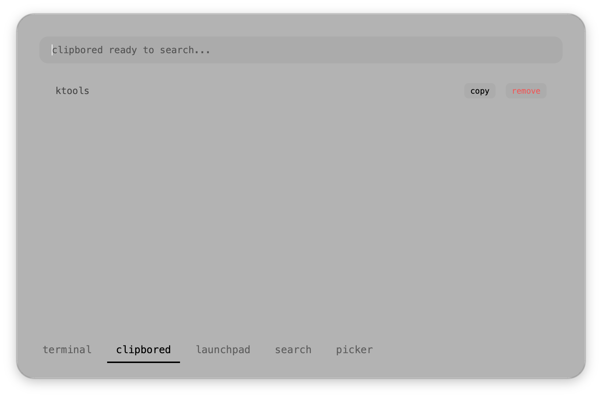

    <pre>
          .__  .__       ___.                              .___
      ____|  | |__|_____ \_ |__   ___________  ____      __| _/
    _/ ___|  | |  \____ \ | __ \ /  _ \_  __ \/ __ \    / __ | 
    \  \__|  |_|  |  |_> >| \_\ (  <_> )  | \/\  ___/  / /_/ | 
     \___  >____/__|   __/ |___  /\____/|__|    \___  > \____ | 
         \/        |__|        \/                   \/       \/ 
    </pre>

    A clipboard manager addon for kshell.

    
    

⠀

## What is clipbored?

`clipbored` is a simple but effective clipboard history manager that mounts directly into your `kshell` dashboard. It silently tracks your clipboard in the background, allowing you to instantly pull up past snippets without opening bulky third-party apps.

### Core Features
* **History Tracking**: Automatically records up to 100 clipboard text entries while the engine is running.
* **Instant Search**: Type in the top bar to instantly filter through your clipboard history.
* **Garbage Collection**: Automatically prunes old UI cards to prevent memory bloat, keeping your shell fast.

⠀

## Screenshots section

⠀

## How to Use (For Users)

1. Make sure you have the **kshell** plugin installed and enabled in `ktools` first, as `clipbored` mounts directly into its interface.
2. Download the `clipbored` `.zip` archive from the Releases page.
3. Open the **ktools Plugin Manager** from your menu bar and click **import plugins** to install it.
4. Hit `Cmd + Space` to open `kshell` and navigate to the `clipbored` tab. 
5. Your clipboard history will appear automatically. Click **copy** to send an item back to your system clipboard, or **remove** to delete it from history.

⠀

by kriaiss.
